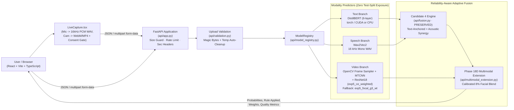

# Multimodal Emotion Recognition — System Architecture

**Schema Version:** Phase 19 (Canonical 7-Class MELD Order)  
**Labels:** `anger`, `disgust`, `fear`, `joy`, `neutral`, `sadness`, `surprise`

---

## 1. End-to-End Request & Inference Architecture

---

## 2. Core Design Invariants

1. **Candidate 4 Preservation (`api/fusion.py`):** Text + Speech inputs preserve exact Candidate 4 logic (`text_anchor_default`, `synergistic_anger_surprise_override`, protected class lockouts for `joy`/`sadness`/`disgust`/`fear`, silent/unusable audio exclusion).
2. **SHA-256 Checkpoint Integrity (`api/config.py`, `facial_emotion/resnet_predictor.py`):** Approved ResNet18 facial primary (`8825d865...`) and focal fallback (`4830ac84...`) weights are verified before `torch.load(weights_only=True)`.
3. **Ephemeral Media Lifecycle (`api/validation.py`, `api/app.py`):** Magic-byte headers are verified on streamed chunks (`<= 50 MB`), written with randomized `emotion_*` filenames strictly inside OS temp space, deleted inside `finally` blocks immediately after inference, and never written alongside user input filenames or logs.
4. **Sequential Grab Video Decode Optimization (`facial_emotion/mtcnn_detector.py`):** Controlled by `EMOTION_API_OPTIMIZED_VIDEO_PIPELINE=1`, short MP4 clips (`<= 240` total frames) decode via single forward `grab()` + `retrieve()` without random keyframe re-seeking and without double container opening.

