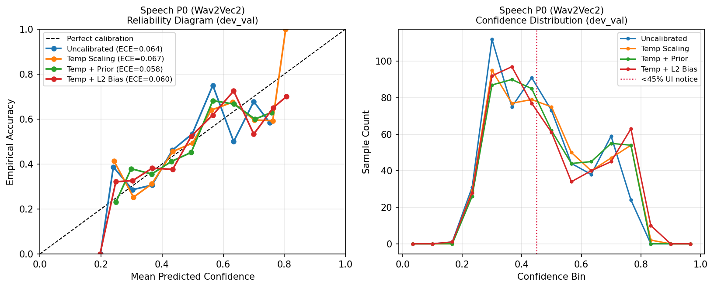
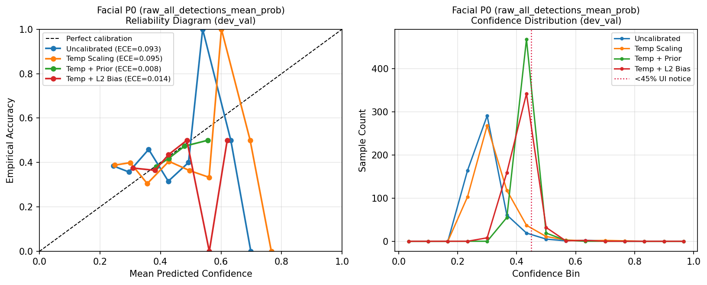
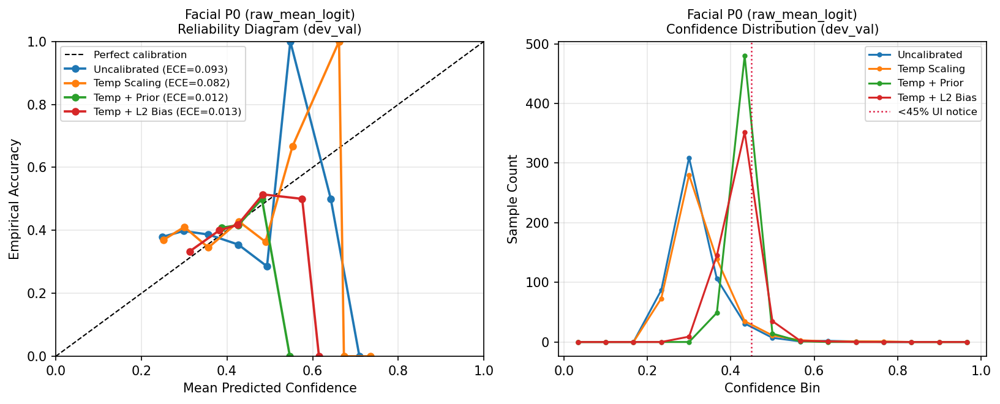

# Phase P1 Probability Calibration Report

**Date:** 2026-11-12  
**Project:** Multimodal Emotion Recognition System  
**Stage:** P1 (Post-hoc Probability Calibration — Leakage-Free Evaluation on MELD `dev_cal` / `dev_val`)

---

## 1. Experimental Protocol & Anti-Leakage Discipline

- **Split Isolation:** Calibration parameters were fit strictly on `dev_cal` (560 utterances across 57 MELD dialogues; Speech valid = 559, Facial valid = 558) and evaluated strictly out-of-sample on `dev_val` (548 utterances across 57 disjoint dialogues; Speech valid = 548, Facial valid = 544) defined in [`meld_dev_cal_val_split.json`](file:///c:/Users/Bhavanth%20D/OneDrive/Pictures/Desktop/Multimodal-Emotion-Recognition-main/Multimodal-Emotion-Recognition-main/models/remediation_splits/meld_dev_cal_val_split.json).
- **Zero Test Leakage:** The held-out MELD `test` split was neither read nor touched during calibration fitting, regularizer search, or validation.
- **L2 Cross-Validation:** For `temp_plus_l2_bias`, regularizer strength (`{0.005, 0.02, 0.05, 0.1, 0.25, 0.5, 1.0, 2.5}`) was chosen via 5-fold dialogue-grouped cross-validation strictly inside `dev_cal`.
- **Reversibility & Asset Protection:** No base model checkpoint was altered. All calibration transforms operate post-hoc on logits through [`calibration_utils.py`](file:///c:/Users/Bhavanth%20D/OneDrive/Pictures/Desktop/Multimodal-Emotion-Recognition-main/Multimodal-Emotion-Recognition-main/calibration_utils.py) and can be toggled off via `use_calibration=False`.

---

## 2. Speech (`Wav2Vec2` P0) Calibration Results (`dev_val`, N = 548)

| Variant | Fitted Params (`dev_cal`) | Acc (%) | Macro-F1 (%) | Weighted-F1 (%) | ECE | NLL | Brier | Mean Conf | `<45%` Rate | Entropy | Decision |
| :--- | :--- | :---: | :---: | :---: | :---: | :---: | :---: | :---: | :---: | :---: | :--- |
| Uncalibrated (P0) | `T=1.0, bias=0` | 46.35 | 24.50 | 41.07 | 0.0638 | 1.4995 | 0.6946 | 46.2% | 51.6% | 1.5029 | Baseline |
| Temp Scaling | `T=0.9371` | 46.35 | 24.50 | 41.07 | 0.0669 | 1.5009 | 0.6955 | 48.4% | 47.4% | 1.4525 | **Rejected** (ECE & NLL regressed) |
| Temp + Bayes Prior | `T=1.1213, alpha=0.308` | 47.63 | 22.64 | 39.60 | 0.0583 | 1.4861 | 0.6909 | 48.5% | 48.2% | 1.4381 | **Rejected** (collapsed Sadness `13.51%->0.0%`) |
| **Temp + L2 Bias** | `T=0.9767, reg=0.05` | **47.26** | **24.58** | 40.91 | **0.0602** | **1.4834** | **0.6895** | 48.7% | 49.5% | 1.4459 | **Accepted** -> `calibration_p1.json` |

### Speech Per-Class F1 Breakdown on `dev_val`

| Class (Support) | Uncalibrated F1 | Temp + L2 Bias F1 | Delta |
| :--- | :---: | :---: | :---: |
| Anger (75) | 42.45% | **43.09%** | +0.64 pp |
| Disgust (11) | 0.00% | 0.00% | 0.00 pp (requires P2 retraining) |
| Fear (20) | 0.00% | 0.00% | 0.00 pp (requires P2 retraining) |
| Joy (80) | 11.01% | 10.53% | -0.48 pp |
| Neutral (228) | 63.91% | 63.40% | -0.51 pp |
| Sadness (58) | 13.51% | **16.44%** | +2.93 pp |
| Surprise (76) | 40.58% | 38.62% | -1.96 pp |

- Saved artifact: [`calibration_p1.json`](file:///c:/Users/Bhavanth%20D/OneDrive/Pictures/Desktop/Multimodal-Emotion-Recognition-main/Multimodal-Emotion-Recognition-main/models/speech_emotion/wav2vec2/calibration_p1.json).
- Reliability visualization: 

---

## 3. Facial (`exp5_ce_weighted_best.pt`) Calibration Results (`dev_val`, N = 544)

| Pooling + Variant | Fitted Params (`dev_cal`) | Acc (%) | Macro-F1 (%) | Weighted-F1 (%) | ECE | NLL | Brier | Mean Conf | `<45%` Rate | Neutral Preds | Decision |
| :--- | :--- | :---: | :---: | :---: | :---: | :---: | :---: | :---: | :---: | :---: | :--- |
| `raw_all_detections_mean_prob` Uncal (P0) | `T=1.0` | 37.68 | **17.96** | **32.17** | 0.0934 | 1.6891 | 0.7838 | 29.6% | 97.8% | 368 / 544 | Retained for v1 |
| `raw_all_detections_mean_prob` + Temp | `T=0.8676` | 37.68 | 17.96 | 32.17 | 0.0947 | 1.6863 | 0.7820 | 32.0% | 95.2% | 368 / 544 | **Rejected** (ECE regressed) |
| `raw_all_detections_mean_prob` + Prior | `T=3.1999, alpha=0.830` | 41.73 | **8.41** | 24.57 | 0.0082 | 1.6152 | 0.7516 | 42.6% | 89.9% | **544 / 544** | **Rejected** (100% Neutral collapse) |
| `raw_all_detections_mean_prob` + L2 Bias | `T=1.9912, reg=0.005` | 41.73 | **8.41** | 24.57 | 0.0138 | 1.6130 | 0.7513 | 41.6% | 87.7% | **544 / 544** | **Rejected** (100% Neutral collapse) |
| `raw_mean_logit` Uncal | `T=1.0` | 38.97 | 17.34 | 31.76 | 0.0928 | 1.6705 | 0.7774 | 31.4% | 96.9% | 404 / 544 | Alternative |
| `raw_mean_logit` + Temp | `T=0.9459` | 38.97 | 17.34 | 31.76 | 0.0820 | 1.6698 | 0.7767 | 32.4% | 96.0% | 404 / 544 | Trades -0.62 pp MF1 vs raw |
| `raw_mean_logit` + Prior / L2 Bias | `T=3.5685 / 2.0885` | 41.73 | **8.41** | 24.57 | 0.0120 | 1.6112 | 0.7512 | 41.6–42.4% | 88.8–92.3% | **544 / 544** | **Rejected** (100% Neutral collapse) |

### Key Facial Diagnosis

1. **Majority-Class Collapse Under Prior Adjustment:** Applying empirical prior biases (`temp_plus_bayes_prior` or `temp_plus_l2_bias`) to the flat, near-uniform logits of `exp5_ce_weighted_best.pt` caused **100% of validation predictions (`544 / 544`) to collapse into `Neutral`**, halving Macro-F1 from `17.96%` to `8.41%` and reducing all six non-neutral class F1 scores to `0.00%`—despite artificially improving ECE (`0.0082`) and marginal Accuracy (`41.73%`).
2. **Why Post-Hoc Calibration Cannot Rescue Facial v1:** Uncalibrated mean top confidence (`29.6%`) already lags empirical accuracy (`37.68%`) while logits hover near uniform (`mean_entropy = 1.7306`, `<45% = 97.8%`). Post-hoc monotonic scaling cannot create discriminative class margins; P2 retraining (`resnet18_v2`) is structurally required.
3. **Engineering Hook Ready for P2:** [`ResNetFacialEmotionPredictor`](file:///c:/Users/Bhavanth%20D/OneDrive/Pictures/Desktop/Multimodal-Emotion-Recognition-main/Multimodal-Emotion-Recognition-main/facial_emotion/resnet_predictor.py) now supports optional logit calibration via `calibration_utils.py`, while Facial v1 remains uncalibrated (`calibrated=False`) by default.

- Reliability visualizations:
  - 
  - 

---

## 4. Downstream Multimodal Impact (`dev_val`, N = 548)

All fusion runs use the frozen Candidate 4 constants (`tau_a=0.20, lambda_max=0.40, kappa_a=1.50, lambda_v=0.00`) in [`api/fusion.py`](file:///c:/Users/Bhavanth%20D/OneDrive/Pictures/Desktop/Multimodal-Emotion-Recognition-main/Multimodal-Emotion-Recognition-main/api/fusion.py) and Phase 18 extension in [`api/multimodal_extension.py`](file:///c:/Users/Bhavanth%20D/OneDrive/Pictures/Desktop/Multimodal-Emotion-Recognition-main/Multimodal-Emotion-Recognition-main/api/multimodal_extension.py).

| Configuration | T+A Acc (%) | T+A MF1 (%) | T+A ECE | T+A+V Acc (%) | T+A+V MF1 (%) | T+A+V ECE | T+A+V NLL |
| :--- | :---: | :---: | :---: | :---: | :---: | :---: | :---: |
| P0 Uncalibrated | 58.76 | 37.55 | 0.0778 | 58.58 | 37.43 | 0.0566 | 1.2163 |
| **Speech Temp+L2 + Facial v1 Uncal (Adopted P1)** | **58.76** | 37.42 | 0.0833 | **58.76** | **37.44** | 0.0618 | 1.2191 |
| Speech Temp+L2 + Facial Logit+Temp | 58.76 | 37.42 | 0.0833 | 58.76 | 37.44 | 0.0657 | 1.2170 |
| Temp+Bayes Prior (both) — *Rejected* | 58.39 | 37.17 | 0.0960 | 58.94 | 37.42 | 0.0707 | 1.2287 |

---

## 5. Verification Status After P1 Implementation

- Modified/Added files:
  - [`calibration_utils.py`](file:///c:/Users/Bhavanth%20D/OneDrive/Pictures/Desktop/Multimodal-Emotion-Recognition-main/Multimodal-Emotion-Recognition-main/calibration_utils.py)
  - [`calibration_p1.json`](file:///c:/Users/Bhavanth%20D/OneDrive/Pictures/Desktop/Multimodal-Emotion-Recognition-main/Multimodal-Emotion-Recognition-main/models/speech_emotion/wav2vec2/calibration_p1.json)
  - [`wav2vec2_model.py`](file:///c:/Users/Bhavanth%20D/OneDrive/Pictures/Desktop/Multimodal-Emotion-Recognition-main/Multimodal-Emotion-Recognition-main/speech_emotion/wav2vec2_model.py)
  - [`resnet_predictor.py`](file:///c:/Users/Bhavanth%20D/OneDrive/Pictures/Desktop/Multimodal-Emotion-Recognition-main/Multimodal-Emotion-Recognition-main/facial_emotion/resnet_predictor.py)
  - [`test_wav2vec2.py`](file:///c:/Users/Bhavanth%20D/OneDrive/Pictures/Desktop/Multimodal-Emotion-Recognition-main/Multimodal-Emotion-Recognition-main/speech_emotion/tests/test_wav2vec2.py)
  - [`test_resnet_integration.py`](file:///c:/Users/Bhavanth%20D/OneDrive/Pictures/Desktop/Multimodal-Emotion-Recognition-main/Multimodal-Emotion-Recognition-main/facial_emotion/tests/test_resnet_integration.py)
- Targeted regression suite (`speech_emotion/tests/test_wav2vec2.py`, `facial_emotion/tests/test_resnet_integration.py`, `api/tests/test_api.py`, `api/tests/test_multimodal_api.py`): **57 passed in 26.01s**.
