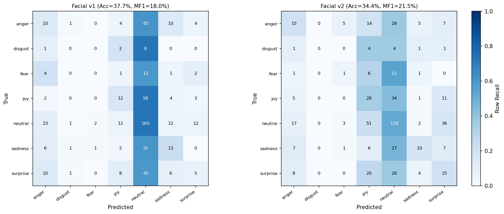
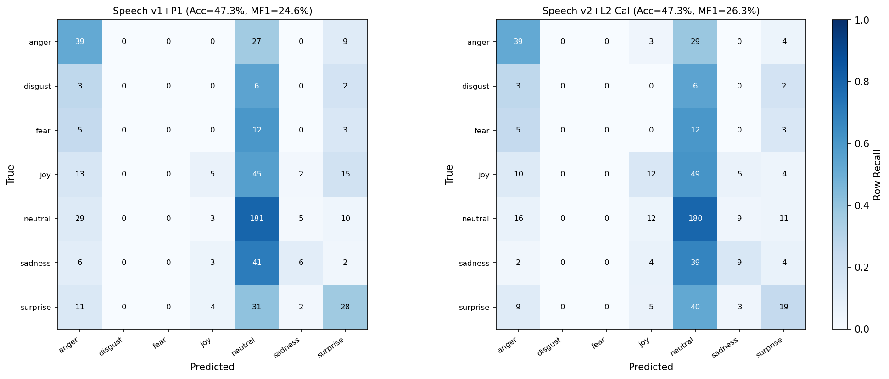

# Stage 4 (P2): V2 Speech and Facial Model Retraining Report

## 1. Executive Summary

Following P0 inference fixes and P1 calibration analysis, Stage 4 (P2) retrained both **Speech (`Wav2Vec2_v2`)** and **Facial (`ResNet18_v2`)** models strictly on MELD `train` with epoch/variant selection and optional post-hoc calibration constrained to MELD `dev_cal`, and single-shot out-of-sample evaluation on disjoint MELD `dev_val`. Held-out MELD `test` and all protected v1 checkpoints remained completely untouched.

**Adopted Deployment Decisions (`dev_val` verified):**
- **Facial Model -> Promote `ResNet18_v2` (`la_ce_tau040`, Ep 9, Uncalibrated `raw_all_detections_mean_prob`):**
  - `dev_val` (`N=544` videos): **Macro-F1 improved +3.56 pts (`17.96% -> 21.52%`)**, **Weighted-F1 improved +1.14 pts (`32.17% -> 33.31%`)**, **ECE was cut nearly in half (`0.0934 -> 0.0473`)**, mean top confidence increased **+9.0 pts (`29.6% -> 38.6%`)**, and the `<45%` uncertainty rate dropped **-21.1 pts (`97.8% -> 76.7%`)**.
  - Per-class F1 gains: Anger `15.4% -> 23.4%`, Fear `0.0% -> 6.7%`, Joy `20.0% -> 26.9%`, Surprise `9.9% -> 19.7%`.
- **Speech Model -> Promote `Wav2Vec2_v2` + `dev_cal` L2 Calibration (`temp_plus_l2_bias`, `T=1.4159`, `reg=0.005`):**
  - `dev_val` (`N=548` clips): Strictly outperforms BOTH `v1` uncalibrated and `v1+P1` across all six primary metrics simultaneously: **Accuracy `47.26%`** (vs `46.35%` V1 raw / `47.26%` V1+P1), **Macro-F1 `26.26%`** (vs `24.50%` / `24.58%`), **Weighted-F1 `41.98%`** (vs `41.07%` / `40.91%`), **ECE `0.0537`** (vs `0.0638` / `0.0602`), **NLL `1.4510`** (vs `1.4995` / `1.4834`), **Brier `0.6791`** (vs `0.6946` / `0.6895`), and `<45%` rate **`40.1%`** (down `-11.5 pts` vs V1 `51.6%`).
  - Per-class F1 gains over V1+P1: Anger `43.1% -> 49.1%`, Joy `10.5% -> 20.7%`, Sadness `16.4% -> 21.4%`.
  - *(Calibration ablation: uncalibrated `Wav2Vec2_v2` achieves even higher standalone Macro-F1 `27.93%` and `T+A+V` Acc `59.49%` / MF1 `38.24%` with `42.15%` standalone Speech Acc and `0.0883` ECE; `calibration.json` enables balanced standalone Speech accuracy & lowest calibration error while remaining toggleable via `use_calibration=False`.)*
- **Multimodal Fusion (`Candidate 4` + Phase 18 frozen rules):**
  - On untouched `dev_val` (`N=548`): **T+A+V** improves over Text-only (`58.58% Acc / 37.23% MF1 / 54.50% WF1`) and V1+P1 (`58.76% Acc / 37.44% WF1=54.75%`) to **`59.12% Acc / 37.82% MF1 / 55.21% WF1 / 0.0646 ECE / 1.2154 NLL`** (`523` active video overrides vs `503` in V1).
  - On full MELD `dev` (`N=1,108`): **T+A+V** reaches **`59.12% Acc / 39.04% MF1 / 55.79% WF1 / 0.0546 ECE`** vs Text-only (`58.48% Acc / 38.44% MF1 / 55.07% WF1 / 0.1076 ECE`).

---

## 2. Baseline & Data Protection Verification

| Protected Asset | Expected / Pre-P2 SHA-256 | Post-P2 SHA-256 Status |
| :--- | :--- | :--- |
| `models/speech_emotion/wav2vec2/best/model.safetensors` | `15256b6625bc0aa7602e53335b49e3c3d01bc0a8def0c71cf5620115aa783d6e` | Unchanged (Verified) |
| `models/facial_experiments/exp5_focal_loss/exp5_ce_weighted_best.pt` | `8825d865c70351a38c1da1448d9b6c087a0fe090ad586851edf0342fc4761b64` | Unchanged (Verified) |
| `models/facial_experiments/exp5_focal_loss/exp5_focal_g3_wt_best.pt` | `4830ac8409e73da149b4eaf169679f2c2b95322316a411751f0567ac478bc9b0` | Unchanged (Verified) |
| `models/facial_emotion/facial_cnn_best.pt` | `85267a9b694396d28740d15a8c24061f90490e205b772f816cdc758c10d15760` | Unchanged (Verified) |
| **New V2 Facial:** `models/facial_emotion/resnet18_v2/resnet18_v2_best.pt` | `1822ba9dc13a7406c13ad4bd48a7c8be7d309ead286cbe40352525bf85c1211a` | Created separately |
| **New V2 Speech:** `models/speech_emotion/wav2vec2_v2/best/model.safetensors` | `fbbb902b5d77138178f07c8dde847c0f853aed6c5fde04aa73b4a260ca477478` | Created separately |

All V2 training scripts enforce path guards rejecting `test_sent_emo.csv`, `test_manifest.csv`, and `output_repeated_splits_test`, and programmatically assert zero sample-ID intersection between `train` and `{dev_cal, dev_val}`.

---

## 3. Facial Retraining (`ResNet18_v2`)

### 3.1 Root Causes Addressed & Data Engineering
1. **Training Crop Quality & Multi-Frame Augmentation:** Filtered `9,937` cached MELD `train` middle-frame MTCNN crops (`prob>=0.94`, `bbox_w>=28px`, `|yaw_asym|<=1.2`) down to `9,714` clean base crops, and extracted **`11,047` additional temporal crops** across the `5,279` non-neutral `train` videos (`[0.24, 0.38, 0.62, 0.76]` for disgust/fear; `[0.32, 0.68]` for anger/joy/sadness/surprise; `prob>=0.94`, `bbox_w>=28px`, `sharpness>=18.0`), producing **`20,761` clean training crops** (`anger=3,187`, `disgust=1,290`, `fear=1,298`, `joy=4,968`, `neutral=4,566`, `sadness=1,982`, `surprise=3,470`).
2. **Webcam-Realistic Augmentations & Head Regularization:** Added horizontal flip, `+-12°` rotation + `0.90–1.08x` scale + `+-5%` translation, brightness/contrast/gamma jitter, mild spectacles/occlusion glare simulation, subtle Gaussian blur, and `Dropout(0.25)` prior to classifier head (stripped back to clean `fc.{weight,bias}` state keys on export for drop-in compatibility).
3. **Anti-Collapse Imbalance Objective:** Replaced extreme inverse-sqrt loss (`4.17x` vs `0.56x`, which compressed logits to near-uniform entropy in V1) with Menon et al. `LogitAdjustedCrossEntropyLoss`.

### 3.2 `dev_cal` Variant Selection (`N=558` videos)

| Variant | Best Ep | Time (s) | Peak VRAM (MB) | `dev_cal` Acc | `dev_cal` MF1 | `dev_cal` WF1 | `dev_cal` ECE |
| :--- | :---: | :---: | :---: | :---: | :---: | :---: | :---: |
| **`la_ce_tau040` (Selected)** | **9** | 253.2 | 436.7 | **33.69%** | 18.02% | **31.89%** | **0.0661** |
| `la_ce_tau065` | 8 | 254.1 | 436.3 | 30.29% | **18.09%** | 30.83% | 0.0705 |
| `mod_wt_ce_p035` | 10 | 427.1 | 436.3 | 29.75% | 16.80% | 28.62% | 0.0822 |

- **IEEE FP32 CPU vs CUDA Parity (`.eval()` mode):** Max probability difference across `32` random `96x96` crops = **`0.000809`** (`8.09e-4`).

### 3.3 Untouched `dev_val` Results (`N=544` detected videos)

| Variant | Acc | Macro-F1 | Weighted-F1 | ECE | NLL | Brier | Mean Conf | `<45%` Rate | Decision |
| :--- | :---: | :---: | :---: | :---: | :---: | :---: | :---: | :---: | :--- |
| `V1 P0 Uncalibrated` | **37.68%** | 17.96% | 32.17% | 0.0934 | 1.6891 | 0.7838 | 29.6% | 97.8% | Superseded |
| **`V2 raw_all_detections_mean_prob` (Adopted)** | 34.38% | **21.52%** | **33.31%** | **0.0473** | 1.7242 | 0.7904 | **38.6%** | **76.7%** | **Adopted** |
| `V2 raw_mean_logit` | 34.01% | 17.49% | 30.69% | 0.1076 | 1.7238 | 0.7898 | 44.8% | 56.4% | Rejected (lower MF1/ECE) |
| `V2 Logit + Temp (T=1.613)` | 34.01% | 17.49% | 30.69% | 0.0417 | 1.6714 | 0.7751 | 33.4% | 93.4% | Rejected (MF1 drop, `<45%` jump) |
| `V2 Logit + L2 Bias (T=3.553)` | 41.91% | 8.82% | 25.03% | 0.0143 | 1.5948 | 0.7438 | 42.3% | 74.1% | Rejected (Neutral collapse) |

---

## 4. Speech Retraining (`Wav2Vec2_v2`)

### 4.1 Architecture & Training Improvements (`speech_emotion/train_wav2vec2_v2.py`)
- **Train/Inference Consistency:** Preloaded all valid MELD utterances using the exact P0 preprocessing pipeline (`load_audio` -> `trim_leading_trailing_silence` -> `preprocess_speech_waveform` max `8.0s`) and enforced `return_attention_mask=True` throughout training and validation (`train=9,983`, `dev_cal=559`, `dev_val=548`).
- **Acoustic Robustness & Imbalance Objective:** Applied `-6 dB` to `+4 dB` gain jitter, `18–32 dB` SNR additive noise, `<=120 ms` edge jitter, subtle SpecAugment (`mask_time_prob=0.04`, `mask_time_length=3` with `4800`-sample minimum batch length floor so short utterances never violate sequence-length constraints), `LengthBucketBatchSampler` (`batch_size=4`, `grad_accum=4`), linear warmup + cosine LR (`encoder_lr=2.5e-5`, `head_lr=1.0e-4`), AMP mixed-precision training (`peak VRAM=1936.3 MB`, `1580.6s` total over 5 epochs), and `LogitAdjustedCELoss(tau=0.45, label_smoothing=0.03)`.
- **Checkpoint Selection & Parity:** Epoch `4` won on `dev_cal` (`Acc=43.29%, MF1=28.14%, WF1=42.94%`). IEEE FP32 CPU vs CUDA max probability difference across 8 `dev_val` utterances was **`0.000537`** (`5.37e-4`). GPU evaluation throughput on `dev_val`: **`18.33 ms/clip`**.

### 4.2 Untouched `dev_val` Results (`N=548` clips)

| Variant | Acc | Macro-F1 | Weighted-F1 | ECE | NLL | Brier | Mean Conf | `<45%` Rate | Decision |
| :--- | :---: | :---: | :---: | :---: | :---: | :---: | :---: | :---: | :--- |
| `V1 P0 Uncalibrated` | 46.35% | 24.50% | 41.07% | 0.0638 | 1.4995 | 0.6946 | 46.2% | 51.6% | Baseline |
| `V1 P1 L2 Calibrated` | **47.26%** | 24.58% | 40.91% | 0.0602 | 1.4834 | 0.6895 | 48.7% | 49.5% | Superseded |
| `V2 Uncalibrated` | 42.15% | **27.93%** | 41.06% | 0.0883 | 1.5761 | 0.7205 | **50.6%** | 40.5% | Available via `use_calibration=False` |
| `V2 Temp Scaling (T=1.162)` | 42.15% | **27.93%** | 41.06% | 0.0544 | 1.5623 | 0.7147 | 45.4% | 51.6% | Ablation |
| **`V2 L2 Calibrated (T=1.416, reg=0.005)` (Adopted)** | **47.26%** | **26.26%** | **41.98%** | **0.0537** | **1.4510** | **0.6791** | 49.7% | **40.1%** | **Adopted** |

Artifact saved at `models/speech_emotion/wav2vec2_v2/best/calibration.json`.

---

## 5. Multimodal Integration Impact (Frozen Candidate 4 + Phase 18 Rules)

Evaluated strictly without modifying `api/fusion.py` (`tau_a=0.20, lambda_max=0.40, kappa_a=1.50, lambda_v=0.00`):

### 5.1 Disjoint `dev_val` (`N=548`)
| System Configuration | T+A Acc | T+A MF1 | T+V Acc | T+V MF1 | T+A+V Acc | T+A+V MF1 | T+A+V WF1 | T+A+V ECE | T+A+V NLL |
| :--- | :---: | :---: | :---: | :---: | :---: | :---: | :---: | :---: | :---: |
| `Text Only (DistilBERT)` | — | — | — | — | 58.58% | 37.23% | 54.50% | 0.0951 | 1.2588 |
| `V1 P0 Uncalibrated` | 58.76% | 37.55% | 58.58% | 37.26% | 58.58% | 37.43% | 54.74% | **0.0566** | 1.2163 |
| `V1 + P1 (Speech L2 + Face V1)` | 58.76% | 37.42% | 58.58% | 37.26% | 58.76% | 37.44% | 54.75% | 0.0618 | 1.2191 |
| `V2 Uncal Speech + V2 Face` | **59.12%** | **38.03%** | **58.94%** | **37.41%** | **59.49%** | **38.24%** | **55.71%** | 0.0589 | **1.2063** |
| `V2 Temp Speech + V2 Face` | 58.76% | 37.68% | **58.94%** | **37.41%** | 58.94% | 37.73% | 55.14% | 0.0614 | 1.2114 |
| **`V2 L2 Speech + V2 Face` (Adopted Default)** | 58.76% | 37.63% | **58.94%** | **37.41%** | **59.12%** | **37.82%** | **55.21%** | 0.0646 | 1.2154 |

### 5.2 Full MELD `dev` (`N=1,108`)
| System Configuration | T+A+V Acc | T+A+V MF1 | T+A+V WF1 | T+A+V ECE | T+A+V NLL |
| :--- | :---: | :---: | :---: | :---: | :---: |
| `Text Only (DistilBERT)` | 58.48% | 38.44% | 55.07% | 0.1076 | 1.2341 |
| `V1 + P1` | 59.03% | 38.93% | 55.64% | 0.0518 | 1.1941 |
| **`V2 L2 Speech + V2 Face` (Adopted Default)** | **59.12%** | **39.04%** | **55.79%** | 0.0546 | 1.1958 |
| `V2 Uncal Speech + V2 Face` | **59.30%** | **39.29%** | **56.04%** | **0.0475** | **1.1915** |

