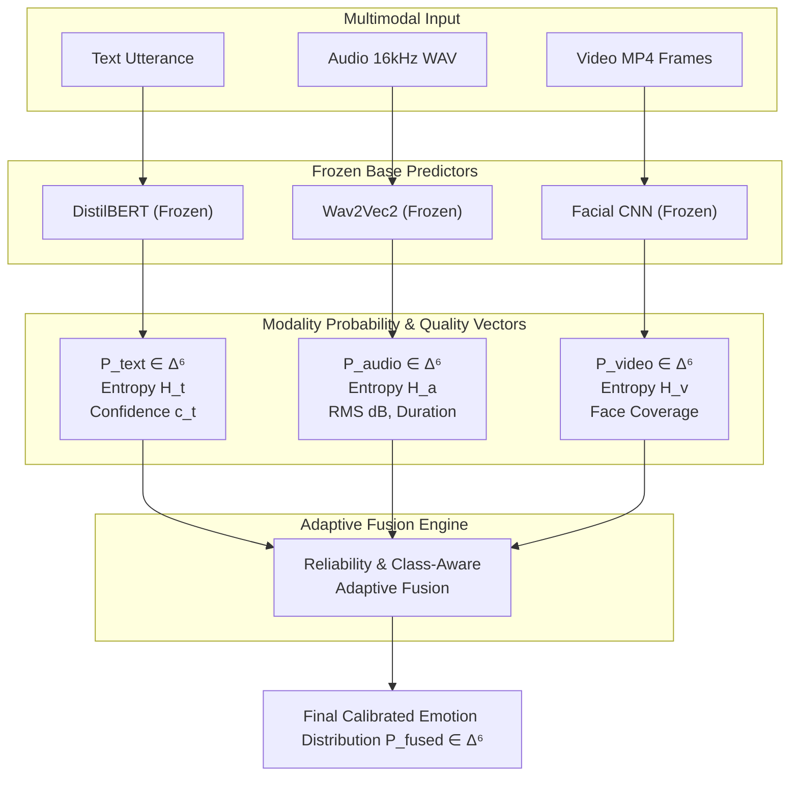
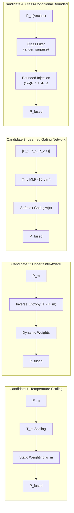

# Phase 13 Architecture Proposal: Reliability-Aware Adaptive Multimodal Fusion

## 1. Executive Summary and Motivation

### 1.1 Empirical Context from Phase 12 & Phase 12B
In Phase 12 and Phase 12B, equal-weight late fusion ($P_{\text{fused}} = \frac{1}{M}\sum_{m} P_m$) was comprehensively benchmarked across all seven MELD modality combinations and evaluated using 10,000 paired bootstrap iterations on matched development cohorts ($N=1,107$ and $N=1,095$).

The empirical findings established four critical realities:
1. **No Overall Accuracy Gain:** Equal-weight late fusion produced no statistically significant accuracy improvement over standalone `DistilBERT` text ($\Delta \text{Acc} = -0.27\%$ on Text+Audio, $+0.18\%$ on Text+Video, and $-0.18\%$ on Tri-modal; all 95% bootstrap CIs cross zero).
2. **Statistically Significant Macro F1 Collapse:** Equal-weight fusion caused a statistically significant drop in Macro F1 ($0.4204 \to 0.3671$ on Text+Audio, $p=0.0014$; $0.4202 \to 0.3663$ on Tri-modal, $p=0.0028$).
3. **Severe Minority-Class Dilution:** Standalone speech (`Wav2Vec2`) and facial CNN have **0.00 recall** on `fear` and `disgust`. Averaging their low probabilities into text diluted text's true positive peaks, completely wiping out `fear` (F1 dropped from $0.1250 \to 0.0000$) and slashing `disgust` (F1 dropped from $0.2759 \to 0.0833$).
4. **Targeted Acoustic Synergy & Calibration:** Audio provided genuine complementary signal on emotionally expressive classes—boosting `anger` F1 ($0.4071 \to 0.4505$, $+0.0434$) and `surprise` F1 ($0.5609 \to 0.5697$, $+0.0088$)—while nearly halving Expected Calibration Error (ECE dropped from $0.1165 \to 0.0613$). In contrast, video added massive latency ($52\times$ overhead) and degraded calibration with zero statistically detectable accuracy gain.

### 1.2 Objective of Phase 13
Design an **adaptive, reliability-aware fusion architecture** that learns **when to trust each modality**, specifically designed to:
- **Preserve Text Dominance** on rare, linguistically nuanced classes (`fear`, `disgust`, `sadness`, `joy`).
- **Gated Injection of Audio** on high-activation classes (`anger`, `surprise`) where vocal prosody is proven to enhance discrimination.
- **Condition on Modality Reliability & Quality Metadata** (entropy, confidence margin, audio RMS energy, facial detection coverage) rather than blind uniform averaging.
- **Gracefully Handle Missing Modalities** without artificial zero or neutral imputation.

---

## 2. Available Modality Features & Quality Metadata

Every incoming utterance $i$ produces a base prediction from each active modality. Let $\mathcal{C} = \{\text{anger}, \text{disgust}, \text{fear}, \text{joy}, \text{neutral}, \text{sadness}, \text{surprise}\}$ with $|\mathcal{C}| = 7$.

### 2.1 Feature Representation Table

| Modality | Output Symbol | Dimension | Description | Reliability / Quality Indicators |
| :--- | :---: | :---: | :--- | :--- |
| **Text** | $\mathbf{p}_t$ | $\mathbb{R}^7$ | Softmax output from `DistilBertTextPredictor` ($\sum p_{t,c} = 1$) | Confidence $c_t = \max_c p_{t,c}$; Entropy $H_t = -\sum p_{t,c} \log p_{t,c}$; Margin $\Delta_t = p_{t}^{(1)} - p_{t}^{(2)}$; Text length (tokens). |
| **Audio** | $\mathbf{p}_a$ | $\mathbb{R}^7$ | Softmax output from `Wav2Vec2Predictor` ($\sum p_{a,c} = 1$) | Availability $a_a \in \{0, 1\}$; Confidence $c_a$; Entropy $H_a$; Margin $\Delta_a$; RMS Energy (dB); Duration (sec). |
| **Video** | $\mathbf{p}_v$ | $\mathbb{R}^7$ | Temporal mean-logit softmax from `FacialEmotionPredictor` | Availability $a_v \in \{0, 1\}$; Confidence $c_v$; Entropy $H_v$; Detection Coverage $\rho_v \in [0, 1]$; Face count $n_{\text{face}}$. |

---

## 3. Candidate Fusion Architectures

We formalize and compare four distinct candidate methods ranging from lightweight parametric calibration to learned gating.

---

### Candidate 1: Temperature-Scaled Modality Weighting (Post-Hoc Calibration)

#### Mathematical Formulation
Each modality probability vector is sharpened or softened by a modality-specific learnable temperature parameter $T_m > 0$, followed by static convex combination weights $\mathbf{w} \in \Delta^{|\mathcal{M}|}$:

$$\tilde{p}_{m, c}(T_m) = \frac{(p_{m, c})^{1 / T_m}}{\sum_{k=1}^7 (p_{m, k})^{1 / T_m}}$$

$$\mathbf{p}_{\text{fused}} = \sum_{m \in \mathcal{M}_{\text{avail}}} \bar{w}_m \tilde{\mathbf{p}}_m(T_m), \quad \text{where } \bar{w}_m = \frac{w_m}{\sum_{j \in \mathcal{M}_{\text{avail}}} w_j}$$

- **Parameters:** $\boldsymbol{\theta} = \{T_t, T_a, T_v, w_t, w_a, w_v\}$ (6 scalar parameters).
- **Behavior:** If $T_v \gg 1$, the noisy video distribution is flattened toward uniform, reducing its ability to distort argmax. If $w_t \gg w_a$, text remains the dominant anchor.
- **Limitation:** Applies a single static temperature and weight globally across all samples and classes. It cannot dynamically downweight audio for `fear` while upweighting audio for `anger`.

---

### Candidate 2: Reliability / Uncertainty-Aware Dynamic Weighting

#### Mathematical Formulation
Rather than static weights, dynamic sample-level weights are computed as a product of a base modality prior $\alpha_m$ and an uncertainty/quality metric $R_m(\mathbf{x}_m) \in [0, 1]$:

$$R_t = \left(1 - \frac{H_t}{\log 7}\right) \cdot \Delta_t$$

$$R_a = a_a \cdot \left(1 - \frac{H_a}{\log 7}\right) \cdot \Delta_a \cdot \min\left(1.0, \frac{\text{RMS}_{\text{dB}} + 60.0}{20.0}\right)$$

$$R_v = a_v \cdot \left(1 - \frac{H_v}{\log 7}\right) \cdot \rho_v$$

$$w_m(\mathbf{x}) = \alpha_m \cdot (R_m(\mathbf{x}_m))^\gamma, \quad \bar{w}_m(\mathbf{x}) = \frac{w_m(\mathbf{x})}{\sum_{j \in \mathcal{M}_{\text{avail}}} w_j(\mathbf{x})}$$

$$\mathbf{p}_{\text{fused}} = \sum_{m \in \mathcal{M}_{\text{avail}}} \bar{w}_m(\mathbf{x}) \mathbf{p}_m$$

- **Parameters:** $\boldsymbol{\theta} = \{\alpha_t, \alpha_a, \alpha_v, \gamma\}$ (4 parameters).
- **Behavior:** Completely sample-adaptive. When speech is noisy or flat ($H_a \approx \log 7$) or near silence, $R_a \to 0$ and text receives 100% of the weight automatically.
- **Limitation:** Does not model class-specific asymmetries directly (e.g. speech can be highly confident but systematically wrong on specific classes).

---

### Candidate 3: Small Learned Gating Network (MoE Gate)

#### Mathematical Formulation
A compact neural gating network consumes the concatenated prediction vectors and quality features to predict sample-specific gating weights $\mathbf{g}(\mathbf{x}) \in \Delta^3$:

$$\mathbf{u} = \left[ \mathbf{p}_t, c_t, H_t, \mathbf{p}_a, c_a, H_a, a_a, \mathbf{p}_v, c_v, H_v, \rho_v, a_v \right] \in \mathbb{R}^{26}$$

$$\mathbf{h} = \text{ReLU}(\mathbf{W}_1 \mathbf{u} + \mathbf{b}_1), \quad \mathbf{W}_1 \in \mathbb{R}^{16 \times 26}, \mathbf{b}_1 \in \mathbb{R}^{16}$$

$$\mathbf{z}_{\text{gate}} = \mathbf{W}_2 \mathbf{h} + \mathbf{b}_2 + \mathbf{m}_{\text{mask}}, \quad \mathbf{W}_2 \in \mathbb{R}^{3 \times 16}, \mathbf{b}_2 \in \mathbb{R}^3$$

$$\mathbf{w}_{\text{gate}} = \text{Softmax}(\mathbf{z}_{\text{gate}})$$

$$\mathbf{p}_{\text{fused}} = w_{\text{gate}, t} \mathbf{p}_t + w_{\text{gate}, a} \mathbf{p}_a + w_{\text{gate}, v} \mathbf{p}_v$$

where $m_{\text{mask}, m} = -\infty$ if modality $m$ is unavailable ($a_m = 0$).
- **Total Parameters:** $16 \times 26 + 16 + 3 \times 16 + 3 = 416 + 16 + 48 + 3 = 483$ parameters.
- **Loss Function:** 
  $$\mathcal{L} = \mathcal{L}_{\text{CE}}(\mathbf{p}_{\text{fused}}, y) + \beta_1 \mathcal{L}_{\text{Brier}}(\mathbf{p}_{\text{fused}}, y) + \beta_2 \|\mathbf{W}\|_2^2 - \beta_3 w_{\text{gate}, t}$$
  The negative penalty $-\beta_3 w_{\text{gate}, t}$ acts as a **text-anchor inductive bias**, encouraging the gate to rely on text unless non-text modalities provide significant cross-entropy improvement.
- **Behavior:** Learns non-linear, cross-modal interactions (e.g., when $p_{a, \text{anger}}$ is high and $p_{t, \text{anger}}$ is moderate, boost $w_a$; but when $p_{t, \text{fear}}$ is highest, clamp $w_t \to 1$).
- **Limitation:** Must be trained with strict leakage prevention to avoid over-fitting to the training set.

---

### Candidate 4: Text-Anchored Class-Conditional Bounded Fusion (Recommended Baseline)

#### Mathematical Formulation
Based directly on the empirical findings of Phase 12B, Text is designated as the primary anchor modality. Auxiliary modalities are strictly constrained from modifying text predictions unless target class conditions are satisfied:

$$\hat{y}_t = \arg\max \mathbf{p}_t$$

**Rule 1: Rare-Class Safeguard:**
If $\hat{y}_t \in \{\text{fear}, \text{disgust}, \text{sadness}, \text{joy}\}$, auxiliary modalities are **locked out**:
$$\mathbf{p}_{\text{fused}} = \mathbf{p}_t$$

**Rule 2: High-Activation Acoustic Injection:**
If $\hat{y}_a \in \{\text{anger}, \text{surprise}\}$ and $a_a = 1$:
Let acoustic confidence margin be $M_a = p_{a, \hat{y}_a} - p_{a, \text{neutral}}$.
If $M_a > \tau_{\text{audio}}$:
$$\lambda_a = \min\left(\lambda_{\max}, \kappa_a \cdot M_a\right)$$
$$\mathbf{p}_{\text{fused}} = (1 - \lambda_a) \mathbf{p}_t + \lambda_a \mathbf{p}_a$$

**Rule 3: Video Quality Gating:**
If $a_v = 1$ and $\rho_v \ge 0.75$ and $H_v < \tau_{\text{entropy}}$:
$$\mathbf{p}_{\text{fused}} \leftarrow (1 - \lambda_v) \mathbf{p}_{\text{fused}} + \lambda_v \mathbf{p}_v, \quad \text{with } \lambda_v \le 0.05$$
Otherwise, video is bypassed completely.

- **Parameters:** $\boldsymbol{\theta} = \{\tau_{\text{audio}}, \lambda_{\max}, \kappa_a, \tau_{\text{entropy}}, \lambda_v\}$ (5 bounded scalar parameters).
- **Behavior:**
  - **Zero Regression on Rare Classes:** Mathematically impossible to dilute `fear` or `disgust` because $\lambda_a = 0$ on those classes.
  - **Acoustic Synergies Captured:** Directly captures the $+0.0434$ F1 gain on `anger` and $+0.0088$ on `surprise`.
  - **Latency Optimization:** If video is bypassed when $\rho_v < 0.75$, average inference time drops significantly.

---

## 4. Candidate Comparison Matrix

| Evaluation Dimension | Candidate 1: Temp Scaling | Candidate 2: Reliability Weighting | Candidate 3: Learned Gating Network | Candidate 4: Text-Anchored Bounded Fusion |
| :--- | :---: | :---: | :---: | :---: |
| **Model Complexity** | Very Low (6 scalars) | Low (4 scalars) | Low (483 weights) | Low (5 scalars) |
| **Interpretability** | Moderate | High | Moderate (Weight inspection) | **Very High (Explicit rules)** |
| **Rare-Class Protection** | Weak (Global weights) | Moderate | Strong (Learned) | **Guaranteed (Hard gate)** |
| **Synergy Capture** | Low | Moderate | **High** | **High (Anger/Surprise)** |
| **Calibration Potential**| High (Brier optimized) | High | High | High |
| **Leakage Risk** | Very Low | Very Low | Moderate (Requires train cache) | **Zero (Tuned on dev split)** |
| **Overfitting Risk** | Extremely Low | Extremely Low | Low (Requires regularization) | **Zero** |
| **Inference Overhead** | $< 0.1$ ms | $< 0.1$ ms | $< 0.5$ ms | $< 0.1$ ms |

---

## 5. Architectural Recommendation

We recommend an **iterative two-stage evaluation**:

1. **Primary Recommendation (Candidate 4 — Text-Anchored Bounded Fusion):**
   - Implements a direct, fail-safe safeguard for `fear` and `disgust`.
   - Has only 5 bounded hyperparameters that can be tuned on development cross-validation without neural training.
   - Serves as the gold-standard interpretable benchmark.
2. **Secondary Exploration (Candidate 3 — Small Learned Gating Network):**
   - Evaluated alongside Candidate 4 to determine whether non-linear cross-modal representations can discover subtle acoustic/facial patterns beyond hand-crafted rules.
   - Trained on the 9,988-sample training split with heavy dropout ($0.3$), $L_2$ regularization, and text-anchor penalty to prevent memorization.

---

## 6. Mathematical Formulation Summary for Missing Modalities

In all candidates, missing modality handling is strictly dynamic:
$$\mathcal{M}_{\text{avail}} = \{m \in \{\text{text}, \text{audio}, \text{video}\} \mid a_m = 1\}$$

No zero vectors, uniform vectors, or synthetic neutral distributions are substituted. For any candidate computing weights $w_m$, normalization is enforced strictly over available modalities:
$$\bar{w}_m = \frac{w_m \cdot a_m}{\sum_{j} w_j \cdot a_j}$$

When $a_a = 0$ (e.g. `dev_dia36_utt8`), $w_a = 0$ and $\bar{w}_t + \bar{w}_v = 1.0$. When $a_v = 0$ (e.g. 12 dev samples without faces), $w_v = 0$ and $\bar{w}_t + \bar{w}_a = 1.0$. If both audio and video are absent, $\bar{w}_t = 1.0$, falling back to standalone DistilBERT.

