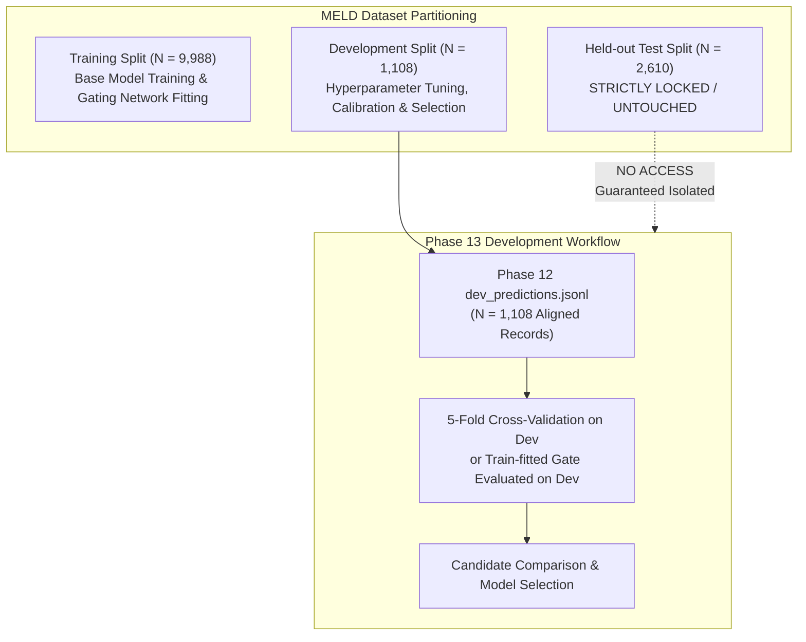
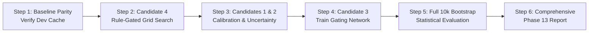

# Phase 13 Experiment Plan: Reliability-Aware Adaptive Multimodal Fusion

## 1. Experimental Objectives

1. Evaluate whether **Reliability-Aware Adaptive Fusion** (Candidates 1–4 from `docs/PHASE13_ARCHITECTURE_PROPOSAL.md`) can achieve superior accuracy, Macro F1, and calibration compared to both:
   - Standalone `DistilBERT` text baseline (Macro F1 = 0.4204, Acc = 60.07%).
   - Equal-weight late fusion (Phase 12 Macro F1 = 0.3671, Acc = 59.80%).
2. Eliminate the catastrophic minority-class collapse on `fear` (F1 $0.0000$ in Phase 12) and `disgust` (F1 $0.0833$ in Phase 12).
3. Preserve or enhance the acoustic synergy gains observed on `anger` (F1 $> 0.45$) and `surprise` (F1 $> 0.57$).
4. Statistically validate improvements via 10,000 paired bootstrap resamples on matched development cohorts.

---

## 2. Strict Leakage Prevention & Data Partitioning

### 2.1 Partitioning Protocol
- **Training Split ($N = 9,988$):**
  - Used exclusively if Candidate 3 (Learned Gating Network) is fitted.
  - Frozen base models generate offline probability and metadata caches for training utterances.
  - No development or test samples are present in any training loss calculation or gradient update.
- **Development Split ($N = 1,108$):**
  - The existing, verified [dev_predictions.jsonl](file:///C:/Users/Bhavanth%20D/OneDrive/Pictures/Desktop/Multimodal-Emotion-Recognition-main/Multimodal-Emotion-Recognition-main/models/phase12_dev_experiments/dev_predictions.jsonl) is used as the evaluation and tuning benchmark.
  - For Candidate 4 (Text-Anchored Bounded Fusion) and Candidates 1 & 2, parameters are optimized using stratified 5-fold cross-validation within the development set to prevent over-fitting to the 1,108 development samples.
- **Held-Out Test Split ($N = 2,610$):**
  - **Zero Access Policy:** The test split is completely locked. No test predictions will be generated, inspected, tuned on, or evaluated during Phase 13 experimentation.

---

## 3. Candidate Methods to Benchmark

Each method will be implemented and benchmarked on the exact same matched development cohorts ($N=1,107$ for Text+Audio and $N=1,095$ for Tri-modal):

### Baseline 0A: Standalone DistilBERT Text (Anchor Baseline)
- Input: Text modality only.
- Purpose: Primary benchmark that any multimodal method must beat or equal across all metrics.

### Baseline 0B: Equal-Weight Late Fusion (Phase 12 Baseline)
- Input: Arithmetic mean of active modalities: $\mathbf{p} = \frac{1}{M}\sum \mathbf{p}_m$.
- Purpose: Demonstrates the failure mode of unweighted fusion.

### Candidate 1: Temperature-Scaled Static Weighting
- Free parameters: Modality temperatures $(T_t, T_a, T_v)$ and weights $(w_t, w_a, w_v)$.
- Search Space:
  - $T_t \in [0.5, 1.5]$, $T_a \in [0.8, 2.5]$, $T_v \in [1.0, 5.0]$
  - $w_t \in [0.5, 0.9]$, $w_a \in [0.1, 0.4]$, $w_v \in [0.0, 0.1]$

### Candidate 2: Reliability / Uncertainty-Aware Dynamic Weighting
- Free parameters: Base modality priors $(\alpha_t, \alpha_a, \alpha_v)$ and exponent $\gamma$.
- Weight formulation: $w_m = \alpha_m \cdot (R_m)^\gamma$, where $R_m$ incorporates entropy $H_m$, margin $\Delta_m$, RMS energy, and face coverage $\rho_v$.
- Search Space:
  - $\alpha_t = 1.0$ (fixed baseline anchor), $\alpha_a \in [0.1, 0.8]$, $\alpha_v \in [0.0, 0.3]$, $\gamma \in [0.5, 2.0]$

### Candidate 3: Lightweight Learned Gating Network (MoE Gate)
- Architecture: 26-dim input $\to$ Linear($26 \to 16$) $\to$ ReLU $\to$ Linear($16 \to 3$) $\to$ Softmax.
- Regularization: Dropout ($p=0.3$), Weight decay ($10^{-3}$), Text-anchor inductive bias loss ($-\beta_3 w_{\text{gate}, t}$).
- Optimization: AdamW, learning rate $10^{-3}$, cosine decay, 20 epochs.

### Candidate 4: Text-Anchored Class-Conditional Bounded Fusion (Recommended)
- Core Mechanism:
  1. If text predicts `fear`, `disgust`, `sadness`, or `joy`, auxiliary modalities are locked out ($\lambda_a = 0, \lambda_v = 0$).
  2. If speech predicts `anger` or `surprise` with margin $M_a > \tau_{\text{audio}}$, inject audio with weight $\lambda_a = \min(\lambda_{\max}, \kappa_a M_a)$.
  3. Video is injected with weight $\lambda_v \le 0.05$ only if face detection coverage $\rho_v \ge 0.80$ and entropy $H_v < 1.5$.
- Search Space:
  - $\tau_{\text{audio}} \in [0.05, 0.25]$
  - $\lambda_{\max} \in [0.15, 0.40]$
  - $\kappa_a \in [0.5, 1.5]$
  - $\lambda_v \in [0.0, 0.05]$

---

## 4. Evaluation Protocol & Success Criteria

### 4.1 Matched-Cohort Metric Suite
All candidate systems will be evaluated on the matched development cohorts ($N=1,107$ and $N=1,095$) with identical sample IDs:
1. **Classification Metrics:**
   - Overall Accuracy
   - Macro-averaged Precision, Recall, and F1
   - Weighted-averaged Precision, Recall, and F1
2. **Per-Class Metrics:**
   - Precision, Recall, and F1 for each of the 7 classes: `anger`, `disgust`, `fear`, `joy`, `neutral`, `sadness`, `surprise`.
   - Complete $7 \times 7$ Confusion Matrices.
3. **Probability Calibration:**
   - Multiclass Brier Score: $\frac{1}{N}\sum_i \sum_c (p_{i,c} - y_{i,c})^2$
   - Expected Calibration Error (ECE) across 10 uniform reliability bins $[0.0, 0.1, \dots, 1.0]$.
4. **Computational Efficiency:**
   - Mean inference latency per sample (ms).
   - Video bypass rate (fraction of samples where expensive video inference is skipped).
5. **Statistical Significance Testing:**
   - 10,000 paired bootstrap resamples on evaluation sample indices with random seed `42`.
   - Two-sided 95% confidence intervals for $\Delta \text{Acc} = \text{Acc}_{\text{candidate}} - \text{Acc}_{\text{text}}$ and $\Delta \text{Macro F1} = \text{Macro F1}_{\text{candidate}} - \text{Macro F1}_{\text{text}}$.
   - Empirical two-sided permutation p-values.

### 4.2 Go / No-Go Decision Gate
A candidate method will be declared superior and eligible for consideration only if:
1. **Macro F1 Parity / Superiority:** $\text{Macro F1}_{\text{candidate}} \ge \text{Macro F1}_{\text{text}}$ (0.4204), with the 95% bootstrap CI lower bound $\ge -0.010$ (no significant degradation).
2. **Minority-Class Protection:**
   - `fear` F1 $\ge 0.100$ (must not drop to 0.000).
   - `disgust` F1 $\ge 0.200$ (must not drop to 0.083).
3. **Synergy Retention:** `anger` F1 $\ge 0.430$ (preserving at least 50% of the acoustic synergy gain over text's 0.407).
4. **Calibration Parity:** Multiclass Brier score $\le 0.5756$ and ECE $\le 0.1165$.

---

## 5. Resource and Execution Requirements

| Resource Dimension | Requirement | Feasibility & Handling |
| :--- | :--- | :--- |
| **Compute Hardware** | CPU-only sufficient; optional CUDA RTX 4050 | Candidates 1, 2, and 4 require only vectorized NumPy operations on cached predictions ($< 2$ seconds for 10,000 bootstrap iterations). Candidate 3 requires $< 1$ minute on CPU to train a 483-parameter gate. |
| **Memory (RAM/VRAM)**| $< 2$ GB system RAM; 0 MB VRAM needed | Development predictions cache is 1.06 MB; all operations run in memory with zero risk of Out-of-Memory (OOM). |
| **Storage** | $< 10$ MB disk space | Generates JSON results and documentation only; no large checkpoints created. |
| **Python Runtime** | `C:\Users\Bhavanth D\anaconda3\python.exe` | Standard dependencies (`numpy`, `scipy`, `scikit-learn`, `torch`). |

---

## 6. Risk Analysis and Mitigation Strategies

| Identified Risk | Severity | Potential Impact | Mitigation Strategy |
| :--- | :---: | :--- | :--- |
| **Dev Split Overfitting** | High | Tuning thresholds on 1,108 samples leads to brittle rules that fail on test data. | Use 5-fold stratified cross-validation within the development split. Report both cross-validated training performance and out-of-fold validation metrics. |
| **Minority Class Extinction** | Critical | Audio/video probabilities overwhelm rare class textual cues. | Hardcode an explicit lockout gate (Rule 1 in Candidate 4) preventing non-text modalities from overriding `fear` and `disgust`. |
| **High Video Latency Overhead** | Moderate | Video model requires ~2.2s per sample, creating severe production bottleneck. | Implement adaptive conditional video execution: skip video face-detection when text confidence is high ($c_t > 0.85$) or when audio provides clear high-confidence signal. |
| **Base Model Drift / Invalidation**| Critical | Re-training base models alters probability distributions. | Base models (`DistilBERT`, `Wav2Vec2`, `Facial CNN`) are strictly frozen. No weights or architectures are modified. |
| **Accidental Test Set Leakage** | Critical | Evaluation or tuning on test split ruins scientific validity. | Hardcode assertions in all Phase 13 scripts (`assert split == 'dev'`). Strictly forbid loading any test manifest or test split file. |

---

## 7. Execution Phasing Roadmap

1. **Step 1:** Establish automated benchmark script `phase13/run_fusion_candidates.py` validating inputs against Phase 12 development baseline.
2. **Step 2:** Implement and evaluate Candidate 4 (Text-Anchored Class-Conditional Bounded Fusion) via 5-fold cross-validation.
3. **Step 3:** Implement and evaluate Candidate 1 (Temperature Scaling) and Candidate 2 (Uncertainty-Aware Weighting).
4. **Step 4:** Generate training prediction cache and fit Candidate 3 (Learned Gating Network) with text-anchor regularization.
5. **Step 5:** Run full paired bootstrap statistical tests ($B=10,000$) across all candidates against standalone Text and Phase 12 late fusion.
6. **Step 6:** Synthesize findings into `docs/PHASE13_REPORT.md` and document whether any method satisfies the Go / No-Go Decision Gate.

