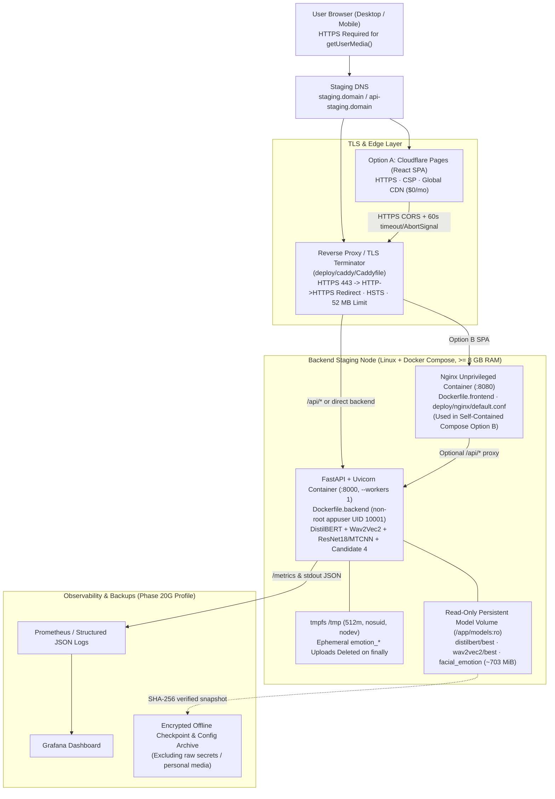

# Phase 20A — Staging Infrastructure Architecture

**Date:** 2026-11-11  
**Project Root:** `Multimodal-Emotion-Recognition-main/`  
**Environment Boundary:** **Staging Only** (`deployed_to_production = False`)

---

## 1. Architecture Overview (Separated Responsibilities)

---

## 2. Separation of Concerns

| Component | Artifact(s) | Placement Decision | Rationale |
|---|---|---|---|
| **React + Vite + TypeScript SPA** | `Dockerfile.frontend`, `deploy/nginx/default.conf` | **Option A:** Cloudflare Pages Free (`VITE_API_BASE_URL=https://api-staging.<domain>`) **Option B:** `frontend` Nginx container (`nginxinc/nginx-unprivileged:1.27-alpine`, `VITE_API_BASE_URL=/api`) | Frontend bundle (`~202 kB` JS + `20 kB` CSS) has zero ML weights; `.dockerignore` prevents copying `models/` or Python code into frontend images |
| **FastAPI + Inference Engine** | `Dockerfile.backend`, `requirements-staging.txt` | Single `--workers 1` Uvicorn container (`mem_limit: 4g`, recommended host `8 GB` RAM) | Loading DistilBERT (`268 MB`), Wav2Vec2 (`378 MB`), ResNet18 (`90 MB`), and MTCNN once per worker (~1.5–1.8 GB RSS) avoids N× RAM multiplication |
| **Model Artifact Storage** | `./models/text_emotion/distilbert/best`, `./models/speech_emotion/wav2vec2/best`, `./models/facial_emotion` | Persistent host directory / named read-only Docker volume mounted at `/app/models:ro` | Decouples `702.7 MiB` static weights from code rebuilds and prevents accidental mutation at runtime; verified by SHA-256 at startup |
| **Ephemeral Media Temp Storage** | OS `/tmp` (`tmpfs: /tmp:size=512m,nosuid,nodev`) | Memory-backed `/tmp` inside backend container | Fast streaming validation and guaranteed deletion inside `finally` (`cleanup_file`); zero disk persistence across restarts |
| **HTTPS / Reverse Proxy** | `deploy/caddy/Caddyfile` | Caddy (`profile: tls`) on ports `80`/`443` | Automatic Let's Encrypt TLS certificates (mandatory so browsers allow live `getUserMedia` mic/cam on staging URL), HSTS, and `52 MB` body cap |
| **Monitoring & Logs** | Prometheus + Grafana (`Phase 20G`) + `stdout` structured logs | Optional Compose `monitoring` profile | Keeps baseline stack lightweight while enabling latency, RSS/VRAM, error-rate, and upload-cleanup observability |

---

## 3. Container & Security Controls Implemented (`Phase 20A`)

- **`.dockerignore`:** Excludes `.env*` (except `.env.example` / `.env.staging.example`), `models/`, `datasets/`, `features/`, `frontend/node_modules/`, `frontend/dist/`, `__pycache__/`, and `docs/` from Docker build contexts.
- **Non-Root Runtime Execution:** `Dockerfile.backend` runs under `appuser` (`UID 10001`); `Dockerfile.frontend` uses `nginxinc/nginx-unprivileged:1.27-alpine` (`UID 101`, port `8080`).
- **Offline Runtime Safety:** `HF_HUB_OFFLINE=1` and `TRANSFORMERS_OFFLINE=1` are set in `Dockerfile.backend` so model initialization fails loudly rather than unexpectedly calling external hubs.
- **Zero Embedded Secrets:** Neither Docker image bakes `.env` or runtime secrets; environment variables are injected via Compose / host secret store.
- **Least Privilege in `docker-compose.staging.yml`:** Drops Linux capabilities (`cap_drop: [ALL]`), enables `no-new-privileges:true`, binds ports `8000`/`8080` to `127.0.0.1` by default (forcing external exposure strictly through HTTPS TLS terminator), and wires container health checks (`service_healthy`).
- **Docker Engine Status on Workstation:** `docker.exe` client `29.8.2` (`desktop-linux` context) is installed, while the Docker Desktop Linux engine daemon (`//./pipe/dockerDesktopLinuxEngine`) was not running during Phase 20A; live `docker build` / `compose up` verification will execute only if Docker Desktop is started or run on the target Linux host.

